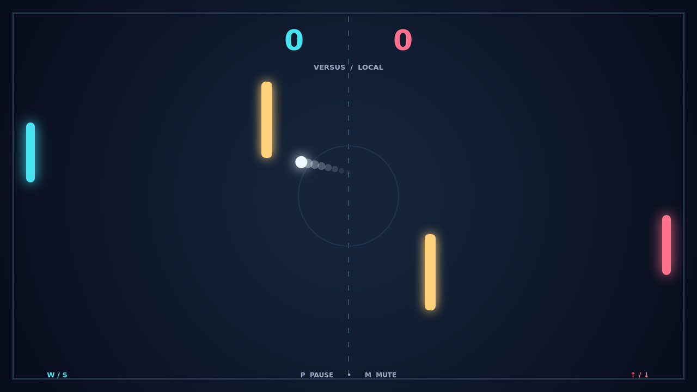

# Carom

Carom is a quick paddle duel played across a dark arena. Choose a solo match against a sharp AI opponent or share a keyboard with a friend, then chase the first point as the ball launches from the center.

Every return changes the rally. Strike near a paddle's edge to send the ball at a new angle, and move the paddle at contact to put spin on the shot. Its path keeps curving after it leaves you, turning a simple save into a surprise attack.

Two gold bars guard the center. A ball can bank off their sides or tips, so a straight route is rarely the only route. Read the next ricochet, reposition, and send your opponent scrambling.

The first player to reach 11 with a two point lead wins. Close matches keep going past 10–10, letting one last curving bank shot decide the duel.

